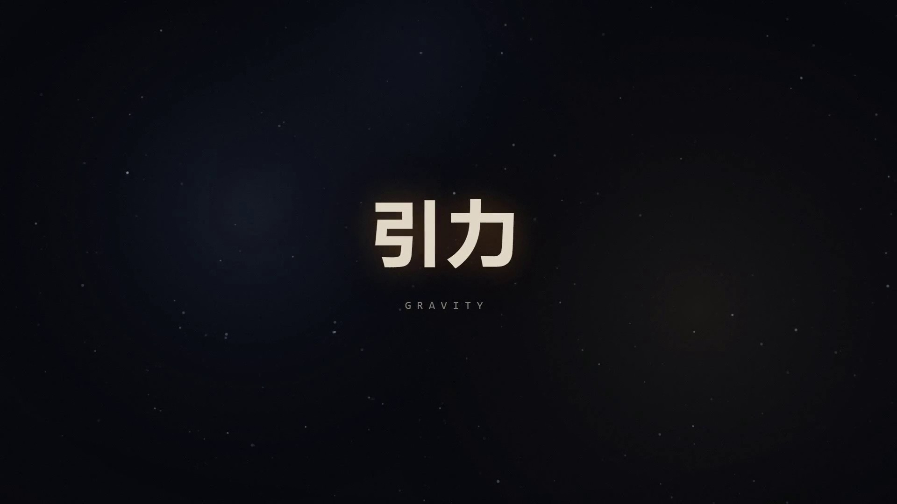
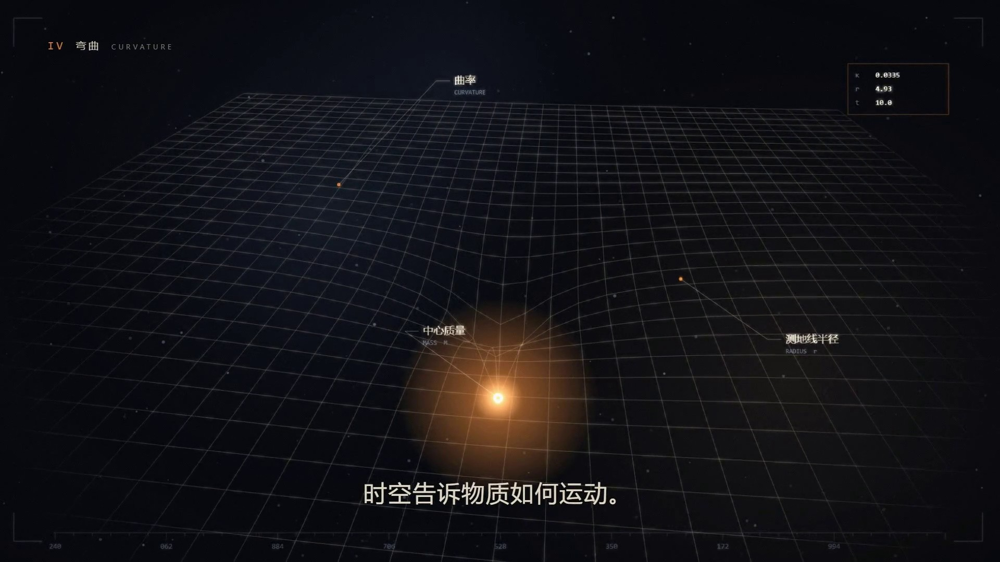
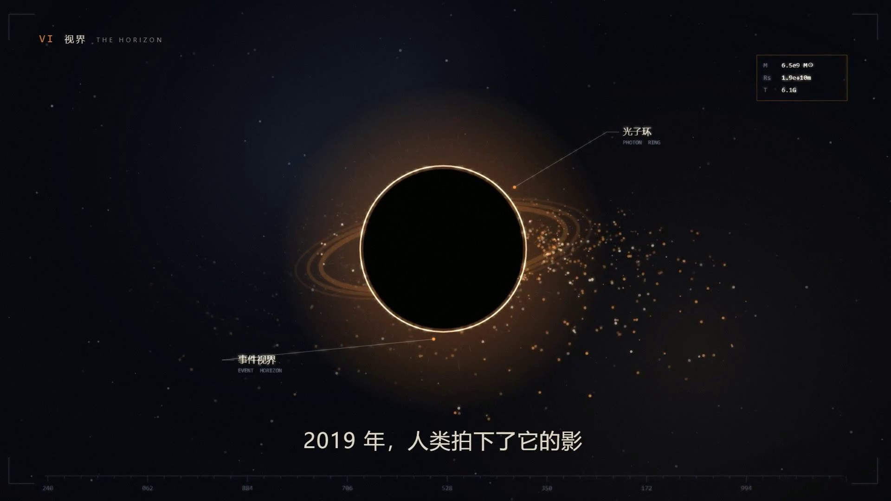
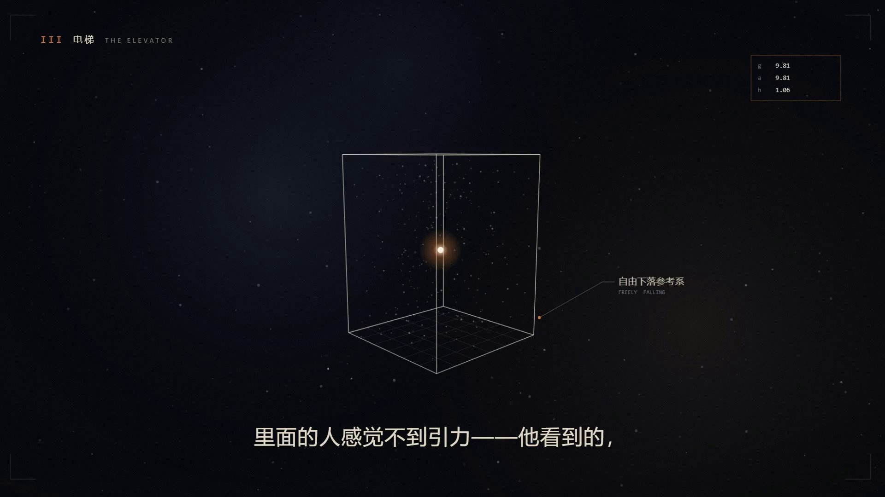

# 《引力》— 用代码复刻 Remotion 式动画的实验
这是一支两分钟的中文科普短片，讲广义相对论。
**每一帧都是代码算出来的。** 没有素材、没有剪辑软件、没有生成式视频模型——一个 `render(t)` 纯函数，喂进去时间，吐出一帧画面。这正是 Remotion 那套"animation as a function of time"的思路，只是这里手写在 Canvas 2D 上。
做这件事的动机：看到一批用 Claude 写出来的代码动画（量子力学、数学概念那一类），质感很特殊——**信息密度高、镜头克制、发光和有颗粒，但风格是从工具链限制里长出来的，不是模型签名**。于是想验证一件事：
> 这套质感能被拆解、复现、量化吗？还是只能靠"感觉对"？
结论：**能拆能量化。** 至少到可以逐帧测量的程度。

---

## 成片

[`film/gravity-v4.mp4`](film/gravity-v4.mp4) — 1920×1080 / 30fps / 117 秒 / H.264 + AAC

> GitHub 可以直接在浏览器里播放仓库内的 MP4。

| | |
|---|---|
|  |  |
|  |  |

八幕：苹果与月亮 → 两个异常 → 电梯 → 弯曲 → 证据 → 视界 → 落版。

---

## 核心做法

### 1. 每帧是时间的纯函数

```js
render(t)   // 给定时间，画出这一帧。无状态、无累积、无副作用。
```

代价是不能做物理模拟；收益是可以跳到任意时刻、逐帧截图、改参数只重渲一镜。

### 2. 六层堆叠

```
L5  后期    bloom（1/6 降采样再放大）→ 暗角 → 颗粒
L4  文字    章节小标 / 大字 / 公式 / 字幕
L3  标注    引线 + 锚点 + 中英双标签 + 读数框
L2  主体    轨道 / 时空网格 / 黑洞
L1  结构    极坐标网格 / 环形刻度 / 坐标轴 / 底部标尺
L0  背景    星云 + 点阵 + 3D 星场 + 尘埃
```

**最大的发现：L1 和 L3 才是"专业感"的来源，不是 L2。**
一个只有主体的画面永远显得简陋；铺上结构层和标注层，同一张图立刻变成"仪器界面"。

### 3. 真 3D 不贵

用同一个 `proj(cam,x,y,z)` 把点放进三维空间，按深度排序、按距离调大小、按焦点做假虚焦——粒子场和吸积盘的体积感就出来了。代码不到 200 行。

### 4. 配乐也是算出来的

`numpy` 合成，不采样任何素材库：D 小调长音铺底 + 每镜换和弦 + 8 秒一次的心跳脉冲 + 稀疏拨弦，转场处噪声扫频、章节处低频落点。（[`renderer/make_audio.py`](renderer/make_audio.py)）

---

## 量化结果

找了同类作品做参照，把"观感"拆成四个可测指标：

| 指标 | 初版 | 最终 v4 | 参考片 |
|---|---|---|---|
| 帧间差 frame_diff | 0.10 | **1.83** | 5.73 |
| 运动帧占比 moving | 7% | **78%** | 91% |
| 结构覆盖率 coverage | 8.4% | **22.1%** | 33.6% |
| 平均亮度 luma | 13 | **18.0** | 41.6 |

> 一律测**源帧**，不测编码后的视频。编码器会把颗粒抹平：同一份内容 mp4v 测出 2.1，H.264 只有 1.5——测出来的不是内容，是编码器。

参考片的绝对值被"2 倍速 + 高亮度"抬高，不必追平。

三个反直觉的结论：

1. **"平坦区标准差"是坏指标**——它会奖励噪点，也受整体亮度影响。换成"结构覆盖率"才反映信息密度。
2. **提亮比重构更有效**——主网格 alpha 从 0.16 提到 0.30，帧间差直接从 1.65 跳到 2.13。之前所有"加了但看不见"的工作都白做在亮度上。
3. **颗粒既是质感也是成本**——它把运动指标拉起来，同时让文件大 4 倍。

---

## 文件

```
film/gravity-v4.mp4      成片（117s）
film/waveform.png        配乐波形，蓝线是镜头切换
renderer/gravity.html    单文件渲染器，浏览器直接打开就能播全片
renderer/export_cdp.py   逐帧渲染（无头 Edge + CDP，0.5 秒/帧）
renderer/make_audio.py   numpy 合成配乐
docs/分镜表.md            八幕的分镜与文案
```

想看怎么把这一整套流程打包给别的 agent 复用 → [code-animation-skill](https://github.com/Shang-en-yee/code-animation-skill)

风格成因的分析（为什么这套美学"恰好避开"了模型的短板）→ [aesthetic-of-constraints](https://github.com/Shang-en-yee/aesthetic-of-constraints)

---

## 已知短板

- 覆盖率 22%，离参考片的 34% 还有距离——信息密度可以再压
- 全程 2D 为主，只有粒子场和吸积盘是真三维投影
- 没有配音；配乐是结构化的铺底，不是为画面写的曲子

MIT License
